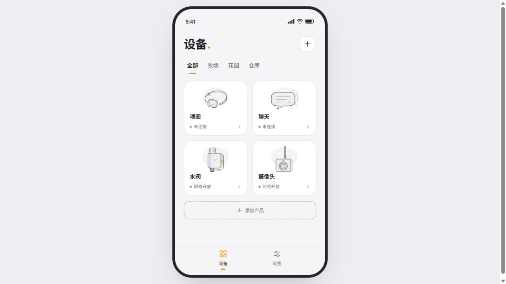

# KEEPTEEN × EdgeZ.ai · App UI 交接

更新：2026-11-16。这是供jason hao重构 App 的可操作网页规格板，生产 App 仍由工程师实现。

## 打开网页

下载本分支后双击本目录 `index.html`，或运行 `open_prototype.bat`，不需要 npm 安装或云端账号。请保留整个文件夹。GitHub 的 HTML 文件页面只展示源码，不会运行网页。

默认 `index.html` 面向用户；`review.html` 独立提供冷启动、已连空网络、活跃网络与失败场景。不要将评审控件放进生产 App。



## 本轮确认的设计

- 首页标题“设备”，用“全部 / 牧场 / 花园 / 仓库”筛选替代“我的产品”。仅“全部”有项圈、聊天、水阀、摄像头四卡；其他区域为空展示，未定义真实归属接口。
- 根导航只有“设备 / 设置”。聊天是独立产品，始终通过聊天卡片进入；产品内部隐藏根导航。
- 项圈：网关下多节点、别名、最近上报、电池电压、信号、定位、示意地图与围栏编辑。
- 聊天：文字、图片、语音的目标流程及发送、失败、重试、送达、已读状态；独立回执和媒体协议按能力表补齐。
- 设置六项：账号、HaLow、通知、通用、帮助、关于。账号/重置使用标准返回页；HaLow先保存手机配置，再选择兼容设备应用。
- 冷白/纯黑、细灰线与克制橙色；透明Logo；关于为KEEPTEEN × EdgeZ.ai，不标软件/硬件分工。12种离线语言。

## 工程师从这里开始

1. [交付总入口](../KEEPTEEN_UI_HANDOFF.md)与[当前用户需求 R01–R41](../ui-handoff/reference/00_USER_REQUIREMENTS.md)。
2. [后端与设备能力清单](../ui-handoff/reference/backend_alignment/BACKEND_CAPABILITIES.md)、[网页接口交接](UI_HANDOFF.md)、[适配契约](ADAPTER_CONTRACT.md)。
3. [地图与围栏专项交接](../ui-handoff/reference/backend_alignment/MAP_GEOFENCE_IMPLEMENTATION_HANDOFF.md)。
4. [完整工程素材说明](../ui-handoff/README.md)、[透明素材预览](../ui-handoff/ASSET_PREVIEW.html)、[729条素材清单](../ui-handoff/ASSET_MANIFEST.json)。

本目录为仓库中网页源码；`../ui-handoff/reference/web_prototype`是同一版的固定交付副本。产品图与Logo应使用素材清单内的当前资源，不使用历史截图或旧独立line-art导出作为新设计标准。修改网页后应重新同步副本和导出素材。

## 功能边界

网页适配器为demo，没有连接真实BLE、SoftAP、MQTT或Appwrite。真实地图下载、深圳定位初始化与可靠围栏闭环尚待修复或实现；聊天图片、独立已读、密码服务、可靠设备确认和产品识别协议仍需对接。手机保存配置不代表设备已应用，浏览器示意地图不代表已下载真实地图。

原生添加路径包含BLE及H7608 SoftAP；网页只展示三条BLE fixture。低功耗项圈节点经HaLow网关，不能把所有产品说成蓝牙直连。水阀与摄像头只有卡片。

## 验证与复核

```text
node verify-board.cjs
python locales/compile-locales.py --check
python sync-radio-catalog.py --check
```

本轮模型检查27,152项、2,107模板；12语言各463条；9地区188条驱动记录。信道源检查需要初始化本仓库固定固件子模块，或用 `--source /path/to/mmregdb.c` 指向对应源码。驱动目录不代表具体SKU获得全部地区认证。浏览器检查记录、素材校验及未完成项见[VALIDATION](../ui-handoff/VALIDATION.md)。

仅查看网页无需依赖；不要输入真实生产口令。未修改原生App、SDK、固件或云端服务，未部署生产，也不自动合并PR。
